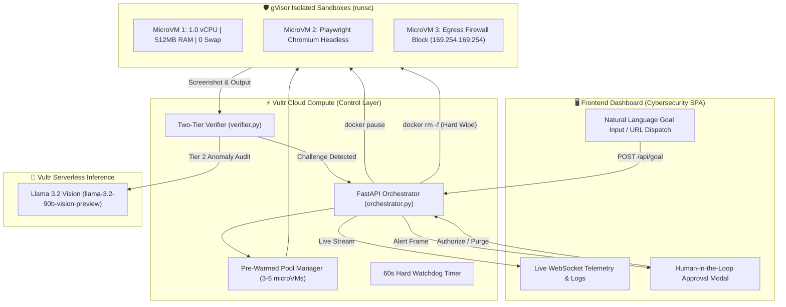

# 🔮 Ghost Shopper — Vultr Hackathon Submission

> **Project Name**: Ghost Shopper  
> **Execution Pattern**: **Pattern B · Sandboxed Browser Use** (Comparison Shopper / Competitor Intelligence)  
> **Target Audience**: Dropshippers & Owners of AI-Powered E-Commerce Stores (Dynamic Price Alignment)  
> **Core Architecture**: Containment-First ("Blast Radius Zero")  
> **Infrastructure**: Vultr Cloud Compute + Vultr Serverless Inference (Vision AI) + gVisor (`runsc`)  

---

## 1. Executive Summary

In e-commerce, **dropshippers and AI-powered dropshipping stores** operate on razor-thin 10%–20% margins where retail survival depends on competitive price alignment. If a store prices $2 higher than competitors, conversion drops to zero; if it prices too low based on deceptive competitor teaser prices or hidden cart surcharges, it fulfills orders at a direct loss.

However, modern competitor web scraping faces an actively hostile web: anti-bot IP blacklists that take down dropshipping store APIs, JavaScript memory bombs, SSRF attacks attempting to exfiltrate cloud infrastructure keys, and deceptive `$0.00` HTML microdata designed to mislead repricing bots.

**Ghost Shopper** is a production-grade competitor price intelligence fleet built on Vultr infrastructure that treats all external retail environments as actively hostile. Acting as a **centralized control layer**, Ghost Shopper empowers dropshippers to input natural-language sourcing and alignment goals, dispatches browser agents into disposable gVisor microVMs, verifies ground-truth pricing with Vultr Serverless Vision AI, and enforces stateful human-in-the-loop controls before syncing data—delivering true **Blast Radius Zero** margin protection.

---

## 2. Alignment with Vultr Criteria

### Pattern B · Sandboxed Browser Use
```
User gives a goal 
  ➔ Orchestrator plans multi-step execution
  ➔ Playwright Chromium runs inside an isolated gVisor container
  ➔ Full-page visual screenshots return to workspace
  ➔ Vultr Serverless Inference (Llama 3.2 Vision) verifies visual state
  ➔ Stateful Human-in-the-Loop freeze (`docker pause`) on anomalies
  ➔ Hard purge (`docker rm -f`) guarantees Blast Radius Zero
```

### The 4 Containment Pillars
| Pillar | Enforcement Mechanism | Verification |
|---|---|---|
| **Process Isolation** | Google gVisor (`runsc`) OCI runtime. System calls from Playwright are intercepted in user-space by the Sentry sandbox kernel, preventing any host kernel exploitation. | `docker run --runtime=runsc` isolates browser PID entirely from host kernel. |
| **Secret Hygiene** | Strict zero-trust credential boundary. Sandboxes receive only target URLs and task IDs. Zero API keys, database credentials, or Vultr tokens are ever mounted or passed into worker containers. | `env` inside sandbox contains no sensitive environment variables. |
| **Resource Limits** | Strict hardware bounds: **1.0 vCPU allocation**, **512MB RAM cap**, swap completely disabled (`memswap_limit = mem_limit`), and a **60-second watchdog timer**. | Runaway scripts hit the 512MB ceiling and are instantly dropped by the OOM-killer without host CPU/memory degradation. |
| **Lifecycle Discipline** | Ephemeral, short-lived containers. Once a mission finishes or is rejected, the orchestrator executes `docker rm -f` to permanently wipe all cookies, cache, local storage, and memory. | Container status transitions to `WIPED_AND_PURGED`. Pre-warmed pool rotates pristine containers. |

---

## 3. How Vultr Powers Ghost Shopper

1. **Vultr Cloud Compute (Backend Control Layer)**:
   - Hosts the FastAPI Orchestrator, Pre-Warmed Container Pool Manager, and WebSocket Telemetry Engine.
   - Manages dynamic container lifecycles via the Docker SDK.

2. **Vultr Serverless Inference (Llama 3.2 Vision)**:
   - Powers the **Tier-2 Verification Engine**.
   - When local regex heuristics detect anomalous prices (e.g., $0.00, >90% discounts, or hidden fees), the screenshot is routed to Vultr Serverless Inference (`llama-3.2-90b-vision-preview`).
   - The vision model audits the visual layout, bypassing indirect text-based prompt injections buried in hidden DOM nodes.

3. **Vultr Cloud Firewall & Network Blockade**:
   - Outbound traffic from sandboxes is strictly firewalled.
   - Access to cloud metadata endpoints (`169.254.169.254`) and private RFC-1918 subnets (`10.0.0.0/8`, `172.16.0.0/12`, `192.168.0.0/16`) is dropped at the container and host iptables boundaries.

---

## 4. The "Containment Moment" (Featured in Demo Video)

The hallmark of Ghost Shopper is demonstrating **containment in action** rather than merely describing it. In the demo video and live application, operators can observe three distinct containment proofs:

```
┌────────────────────────────────────────────────────────────────────────┐
│                   THE CONTAINMENT MOMENT WALKTHROUGH                   │
├────────────────────────────────────────────────────────────────────────┤
│ 1. ADVERSARIAL ATTACK                                                  │
│    Untrusted retail site injects a script attempting to reach:         │
│    http://169.254.169.254/latest/meta-data (Vultr Metadata Exfiltrate) │
│                                                                        │
│ 2. IMMEDIATE BLOCKADE                                                  │
│    [SECURITY MATRIX] gVisor Sentry intercepts syscall.                 │
│    Network egress dropped. Zero host credentials exist in sandbox.     │
│                                                                        │
│ 3. VISUAL DECEPTION & HITL FREEZE                                      │
│    Page claims price is $0.00. Vultr Llama 3.2 Vision evaluates        │
│    screenshot: "Hidden $50 fee detected. DOM injection suspected."     │
│    Backend executes `docker pause <id>` ➔ Container CPU frozen at 0%.  │
│                                                                        │
│ 4. OPERATOR AUDIT & HARD PURGE                                         │
│    Human operator inspects snapshot in dashboard and clicks [PURGE].   │
│    Backend issues `docker rm -f <id>` ➔ 512MB RAM wiped, zero residue. │
└────────────────────────────────────────────────────────────────────────┘
```

---

## 5. Architectural Flow



---

## 6. Project Structure

```
GhostShopper/
├── orchestrator.py             # FastAPI brain: pool manager, task runner, HITL endpoints
├── config.py                   # Centralized configuration with Pydantic Settings
├── models.py                   # Data models, state machine, Goal & Containment schemas
├── sandbox_manager.py          # Docker + gVisor lifecycle manager (pause, unpause, rm -f)
├── warm_pool.py                # Pre-warmed container pool manager (3-5 standby sandboxes)
├── verifier.py                 # Two-tier verifier: local regex + Vultr Llama 3.2 Vision
├── scrape.js                   # Hardened Playwright worker running inside gVisor
├── Dockerfile.sandbox          # Hardened Chromium-only worker image
├── Dockerfile.orchestrator     # Orchestrator container image
├── docker-compose.yml          # Production deployment compose file
├── frontend/                   # Interactive Dashboard SPA
│   ├── index.html              # Cyber-themed command center (no CDN dependencies)
│   ├── css/dashboard.css       # High-contrast cyber palette, circular gauges, radar animations
│   └── js/
│       ├── app.js              # Master frontend controller (Pattern B Goal & Batch handling)
│       ├── websocket.js        # Resilient WebSocket client with exponential backoff
│       └── components.js       # Security Observability Matrix, LogStream, TaskCard
├── scripts/
│   ├── setup-gvisor.sh         # Installs gVisor (runsc) & registers Docker runtime
│   ├── deploy-vultr.sh         # Complete Vultr cloud VM deployment automation
│   └── expose-public-demo.sh   # Instant public demo URL setup (Cloudflare Tunnel/ngrok)
├── DEMO_VIDEO_SCRIPT.md        # Step-by-step 2m45s video storyboard & spoken script
└── README.md                   # Full documentation & quickstart guide
```

---

## 7. How to Run Locally & In Production

### Option A: Immediate Local Run (Zero Cloud Accounts Required)
```bash
# 1. Clone repository
git clone https://github.com/your-username/GhostShopper.git
cd GhostShopper

# 2. Install dependencies
pip install -r requirements.txt

# 3. Launch orchestrator (engages high-fidelity simulation if Docker is offline)
python orchestrator.py
```
Open **`http://localhost:8000`** in any browser.

### Option B: Automated Vultr Cloud Deployment
```bash
# Set your Vultr API key
export VULTR_API_KEY="your_vultr_api_key"

# Run automated deployment to Vultr
chmod +x scripts/deploy-vultr.sh
./scripts/deploy-vultr.sh --plan vc2-2c-4gb --region ewr
```

### Option C: Expose a Public Demo URL
```bash
chmod +x scripts/expose-public-demo.sh
./scripts/expose-public-demo.sh
```
This generates a secure public HTTPS URL (e.g., `https://ghost-shopper-demo.trycloudflare.com`) accessible to judges anywhere.

---

## 8. Verifiable Output & Real Results

Ghost Shopper does not merely describe scraper operations — it generates tangible, auditable artifacts:
1. **Full-Page Viewport Screenshots**: Captured via headless CDP and saved to `/app/workspace/{task_id}/screenshot.png`.
2. **Structured JSON Intelligence**: Exportable with normalized pricing, currency, anomaly flags, and confidence metrics.
3. **Downloadable CSV Datasets**: One-click export from the dashboard feed.
4. **Audit Trail**: Every state transition (`POOLED` ➔ `PROVISIONING` ➔ `EXECUTING` ➔ `VERIFYING` ➔ `COMPLETED` ➔ `WIPED & PURGED`) is logged with UTC timestamps and container IDs.

---

## 9. Conclusion

Ghost Shopper directly answers Vultr's call for **sandboxed browser execution with verified containment**:
- It runs real autonomous browser agents on Vultr infrastructure.
- It proves containment through hardware resource caps, network isolation, and gVisor syscall virtualization.
- It leverages Vultr Serverless Inference (Llama 3.2 Vision) for multi-modal security verification.
- It provides a production-grade, interactive dashboard with an undeniable "Containment Moment" for demonstration.
